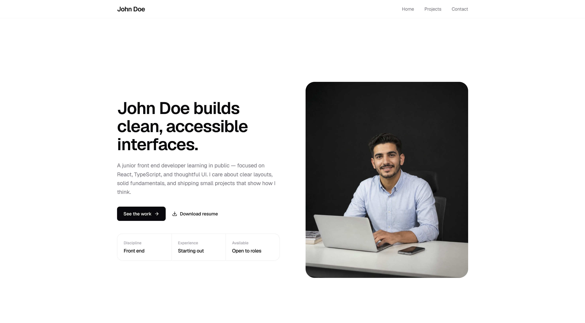

# Clarity Developer Set

A light, minimal developer portfolio template built with Next.js 14, TypeScript, Tailwind CSS, and shadcn/ui. Designed pages are included — edit content in config and JSON, then deploy.

**Live demo:** [clarity-developer-set.vercel.app](https://clarity-developer-set.vercel.app/)




---

## What's inside

- **Routes**: Home (`/`), `/projects`, `/projects/[slug]`, `/contact`
- **Home sections**: Hero, Services, Disciplines, Case studies
- **Projects page**: Alternating selected-work rows with deliverables and case-study links
- **Case study pages**: Long-form detail with sidebar, technologies, related projects, and next-project nav
- **Contact page**: Channels, availability, and a message form (UI-only until you wire a provider)
- **Global chrome**: Navbar + footer from `config/site.ts`
- **Content workflow**: Branding in `config/site.ts`, projects in `data/projects.json`
- **No backend, no database, no env vars required**

---

## Quick start

```bash
npm install
npm run dev
```

Open <http://localhost:3000>.

```bash
npm run build
npm run start
```

---

## How to edit your portfolio

1. **Edit `config/site.ts`** — name, role, email, social links, nav, section copy
2. **Edit `data/projects.json`** — add, edit, or remove projects and case-study content
3. **Swap images in `public/`** — hero, service previews, optional resume PDF
4. **Run `npm run dev`** to preview
5. **`git commit` and `git push`** — your host redeploys

No CMS, no database, no admin login.

### Project schema

Required: `id`, `slug`, `title`, `description`, `category`, `tech`, `completed`.

Optional: `featured`, `status`, `label`, `year`, `role`, `deliverables`, `keyOutcome`, `summary`, `caseStudy`, `client`, `duration`, `completionDate`, `websiteUrl`, `githubUrl`, `tags`, `highlights`, `impact`, `coverImage`, `screenshots`.

Enums:

- `category`: `"creative" | "real-estate" | "corporate"`
- `tech`: `"wordpress" | "react" | "nextjs" | "php"`
- `status`: `"published"` (default) or `"draft"` (hidden)

Full schema: top of `lib/projects-data.ts`.

---

## Where to edit

| What you want to change | File |
| ----------------------- | ---- |
| Site name, role, email, social | `config/site.ts` |
| Page title & meta description | `config/site.ts` (via layout) |
| Footer blurb & availability | `config/site.ts` → `footer` |
| Hero headline, bio, CTAs, stats, image | `config/site.ts` → `hero` |
| Services list & preview images | `config/site.ts` → `services` |
| Disciplines / skills | `config/site.ts` → `disciplines` |
| Case studies section title & intro | `config/site.ts` → `caseStudies` |
| Projects page title & intro | `config/site.ts` → `projectsPage` |
| Case study page labels | `config/site.ts` → `caseStudyPage` |
| Contact channels, open-to list, form copy | `config/site.ts` → `contactPage` |
| Projects (every page) | `data/projects.json` |
| Hero image | `public/hero.png` |
| Service preview images | `public/services/` |
| Resume download (`hero.secondaryCta`) | `public/resume.pdf` |
| Contact form wiring | `components/contact-form.tsx` |
| Theme colors | `app/globals.css` |

See `CUSTOMIZATION.md` for details.

---

## Project structure

```
clarity-developer-set/
├── app/
│   ├── globals.css
│   ├── layout.tsx
│   ├── page.tsx                 # home → hero, services, disciplines, case studies
│   ├── contact/page.tsx
│   └── projects/
│       ├── page.tsx             # selected-work rows
│       └── [slug]/page.tsx      # case study detail
├── components/
│   ├── site-navbar.tsx
│   ├── site-footer.tsx
│   ├── contact-form.tsx
│   ├── sections/
│   │   └── hero-section.tsx
│   ├── portfolio/
│   │   ├── services-section.tsx
│   │   ├── disciplines-section.tsx
│   │   ├── case-studies-section.tsx
│   │   ├── selected-projects-section.tsx
│   │   └── project-case-study.tsx
│   └── ui/                      # shadcn primitives
├── config/site.ts
├── data/projects.json
├── lib/projects-data.ts
└── public/
    ├── hero.png
    ├── resume.pdf               # add your PDF (optional)
    └── services/
        ├── responsive-layouts.png
        ├── react-interfaces.png
        ├── landing-pages.png
        └── ui-polish.png
```

---

## Documentation

| File | Purpose |
| ---- | ------- |
| `QUICK-START.md` | 15-minute setup checklist |
| `CUSTOMIZATION.md` | File-by-file edit guide |
| `DEPLOYMENT.md` | Vercel-first deploy guide |
| `AI_CUSTOMIZATION_PROMPT.md` | Copy-paste AI prompt |
| `LICENSE.md` | MIT — free to use, share, and fork |

---

## License

This project is free and open source under the [MIT License](LICENSE.md). Clone it, customize it, publish it publicly, and use it for personal or commercial work.
